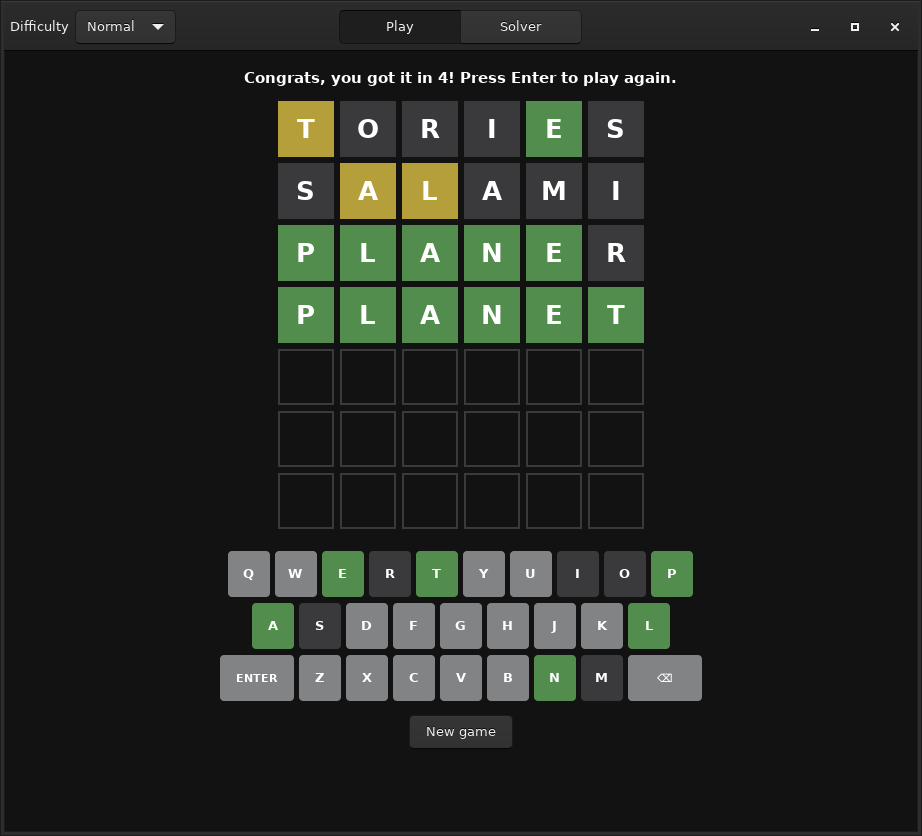
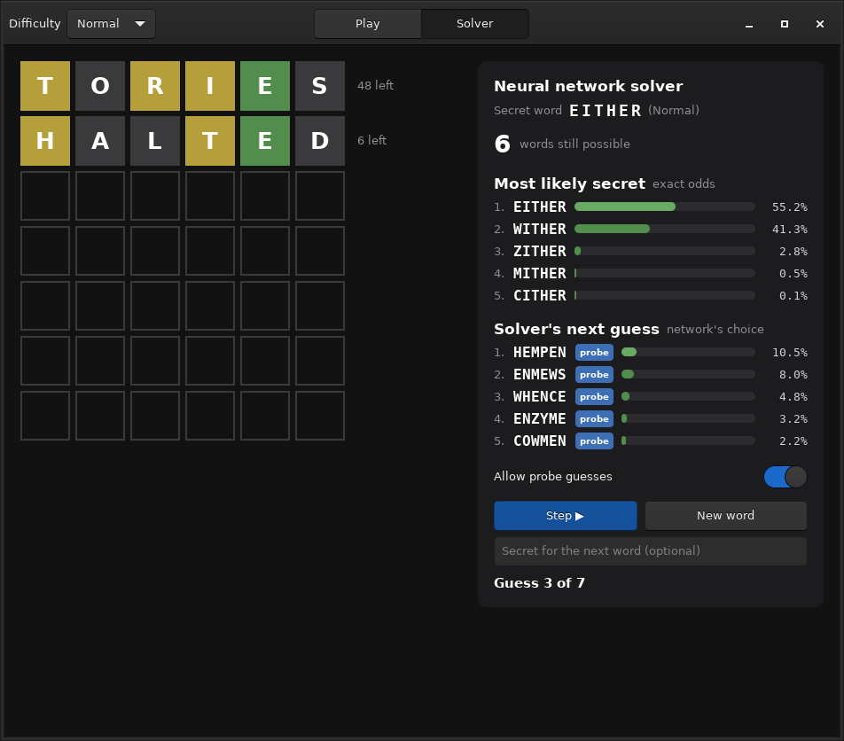

# 6dle

Wordle with six letter words, written entirely in C, with a GTK interface, a
difficulty setting and a **neural network solver** you can watch play, one
guess at a time.

| Play | Solver |
| --- | --- |
|  |  |

- **Play** in a GTK window (or in the terminal, the original interface).
- **Difficulty**: *Easy*, *Normal*, *Hard* or *Any word*. It controls how
  the secret word is picked, based on how familiar it is and how many
  look-alikes it has.
- **Watch the solver**: press *Step* to make it guess. Next to the board it
  shows the **5 most likely secrets with their exact probability** and the
  network's **5 preferred next guesses**.
- The solver is a **feed-forward neural network** trained to imitate an
  expert solver. It may play **probe guesses**: words that can't be the
  secret but narrow things down better. Over 3,000 random games per level
  it **won every game, in 3.6–3.8 guesses on average**.
- Everything is C11: the game, the GUI, the neural network (forward pass,
  backpropagation, Adam), the training and analysis tools, and the tests.
  The only library is GTK 3.
- `make test` runs 49 unit tests under AddressSanitizer + UBSan, plus an
  end-to-end train-and-solve run.

---

## Contents

1. [What's new in version 2](#whats-new-in-version-2)
2. [Quick start](#quick-start)
3. [Rules](#rules)
4. [Using the GUI](#using-the-gui)
5. [Terminal version](#terminal-version)
6. [Make targets](#make-targets)
7. [Project layout](#project-layout)
8. [How the code fits together](#how-the-code-fits-together)
9. [The neural network solver](#the-neural-network-solver)
10. [Training](#training)
11. [Results](#results)
12. [Best starting words](#best-starting-words)
13. [Tests](#tests)
14. [Should the GUI move to GTK 4?](#should-the-gui-move-to-gtk-4)
15. [History](#history)
16. [Troubleshooting](#troubleshooting)
17. [Ideas for later](#ideas-for-later)
18. [Credits](#credits)

---

## What's new in version 2

Version 1 had a GTK interface, a "hard mode" neural network solver (it only
ever guessed words that could still be the secret) and secrets drawn
uniformly from the 22,159-word list. Version 2 changes the following, from
most to least visible.

### 1. Probe guesses: the solver may play a word that can't be the secret

**Before.** The solver only chose among words still consistent with the
colours (hard mode). That sounds sensible: every guess has a chance to win.
But it fails on "trap" families where many words differ by one letter. Once
the solver knows `_ITHER` it can only try them one at a time. Version 1
lost about 1.1% of games this way.

**Now.** The solver may also play any other word when that splits the
remaining words better. The word can't win, but it tests several of the
missing letters at once. Such guesses are tagged **probe** in the GUI. Once
two or fewer words are left, a probe can never help, so the solver always
guesses a possible word then.

**Example: secret `EITHER`**, same network, with and without probes:

```
hard mode                               with probes
22182 left  TORIES  y.yyg.              22182 left  TORIES  y.yyg.
   48 left  LINTER  .g.ygg                 48 left  HALTED  y..yg.  (probe)
    7 left  HITHER  .ggggg                  6 left  HEMPEN  yy..g.  (probe)
    6 left  DITHER  .ggggg                  1 left  EITHER  gggggg  solved in 4
    5 left  ZITHER  .ggggg
    4 left  WITHER  .ggggg
    3 left  CITHER  .ggggg  lost
```

(`g` green, `y` yellow, `.` grey.) HALTED can't be the secret, since it
contains letters already known to be grey. But it tests H, L, D and the A at
once and leaves only 6 words. HEMPEN then separates EITHER from WITHER,
ZITHER, MITHER, NITHER and CITHER.

**Example: secret `BAKING`.** After TORIES, 276 words remain. Hard mode
walks WADING, CAPING, HAYING, FAZING, BANING… and loses. With probes, CAMPLY
then WINKED leave 32 and then 2 words (BAKING, FAKING), and it wins in 5.

**Effect.** Over 3,000 random games per difficulty, losses went from 1–3%
to **zero**, and the average dropped by about 0.17 guesses (table in
[Results](#results)). Over every one of the 22,182 possible secrets, the
network loses only one game (see [Best starting words](#best-starting-words)).
Hard mode is still available: switch off *Allow probe guesses*, or pass
`--hard` to the terminal version.

### 2. Exact "most likely secret" odds

**Before.** The panel showed one list: the network's preferred next guesses,
with the network's confidence in %. Every remaining word was equally likely
to be the secret, so that list couldn't show which word was likely to *be*
the answer.

**Now.** Secrets are no longer always equally likely (see 3). So the panel
has a second list, **Most likely secret**, with true probabilities from
Bayes' rule:

```
P(secret = w | colours so far) = prior(w) / sum of prior(v) over every v still possible
```

where `prior` is the chance that the current difficulty picks `w`. This is
exact, not learned: no network can do better than this formula.

**Example: `EITHER` on Normal.** After TORIES and HALTED, six words remain.
With all words equally likely, each would be 16.7%. Normal favours familiar
words, so the panel shows `EITHER 55.2%, WITHER 41.3%, ZITHER 2.8%, MITHER
0.5%, CITHER 0.1%` (screenshot above).

The second list, **Solver's next guess**, is the network's softmax over the
words it may play: how strongly it prefers each move.

### 3. Difficulty levels, from word frequencies

**Before.** The secret was drawn uniformly from all 22,159 words, including
Scrabble-only words like AALIIS.

**Now.** `data/wordFreq.txt` gives each word's **Zipf frequency**: log₁₀ of
how many times it appears per billion words of real English (from
[wordfreq](https://github.com/rspeer/wordfreq)). 3 means once per million
words (*bistro, condor*); 0 means the corpus never saw it (10,224 words,
nearly half the list). A second measure counts each word's **familiar
look-alikes**: familiar words (Zipf ≥ 2.5) that differ from it in exactly
one letter. BATTER has 13 (BETTER, BITTER, BUTTER, MATTER, LATTER, BANTER…),
PEOPLE has 0. Look-alikes are what make a word a trap.

| Level | How the secret is picked | Words | Examples |
| --- | --- | --- | --- |
| **Easy** | Zipf ≥ 3.5 and at most 2 familiar look-alikes | 1,456 | client, sitcom, permit, amount |
| **Normal** (default) | smooth weighting by frequency: Zipf ≥ 3 almost always, rarer words now and then, 0.5% unseen words | 4,411 core (≈ 6,560 effective) | buffet, danger, clouds, rotten |
| **Hard** | Zipf 2–3 (known but uncommon), or Zipf ≥ 3 with 5+ familiar look-alikes | 4,325 | thatch, busboy, wallet, batter |
| **Any word** | all 22,182 words, equally likely (version 1's behaviour) | 22,182 | aaliis, zymome… |

The levels really do differ in difficulty. The solver needs on average
**3.59** guesses on Easy, **3.72** on Normal and **3.81** on Hard (3,000
games each). *Any word* is 3.70: obscure words are hard for people but not
for the solver, which knows the whole list.

### 4. A better teacher: expected guesses instead of information

**Before.** The network imitated an *entropy* expert. It chose the guess
whose colours carried the most information (bits), among possible words
only.

**Now.** The expert (`src/solver/expert.c`) estimates the **expected number
of guesses to finish** for each candidate move:

```
cost(g) = 1 + sum over colour patterns p (except all-green) of P(p) * G(words left after p)
```

`G(n)` is how many more guesses it takes, on average, once `n` words remain.
It was **measured from the expert's own games**: G(1) = 1, G(2) = 1.5,
G(4) = 1.84, G(16) = 2.27, G(256) = 2.86, and G(22,182) = 3.66, interpolated
on log₂ n. This differs from entropy in two ways that matter:

- **Winning now has value.** A possible word that also splits well can end
  the game immediately. The all-green pattern costs 0 extra guesses.
- **Probes and possible words compete on equal terms.** Entropy alone would
  happily play a probe when two words are left (1 bit either way); the cost
  formula knows guessing one of them wins half the time.

Scoring every one of 22,182 words against hundreds of remaining words at
every move is too slow, so a cheap letter-statistics heuristic first
shortlists the 600 most promising words overall and 600 possible words.
Only those get the exact cost. The very first move has exact costs for all
22,182 × 22,182 pairs, computed once (≈ 2 s on 12 threads). TORIES comes out
best at 3.69 expected guesses.

**Effect.** The expert itself went from 98.84% wins / 3.857 guesses (entropy,
hard mode) to **100% / 3.64** (cost, probes).

### 5. One network for both modes

**Before.** The network scored each possible word through its letters: which
letter sits where, which letters it contains, and which appear twice. The
softmax ran over possible words only.

**Now.** Each word gets two extra inputs to its score: *"is still possible"*
and *"its probability of being the secret"* (the chance it wins right now).
So the network can weigh probes against possible words. Each training
position has **two targets**: the expert's choice among all words, and its
choice among possible words only. The same network therefore plays both
modes: with probes, the softmax runs over every word not played yet; in
hard mode, the same scores are restricted to possible words. Words already
played are always excluded. A probe isn't eliminated by its own colours, so
without that rule the network could repeat one.

### 6. Why the solver ignores the difficulty when choosing its guesses

On Normal, the secret is probably a common word. Shouldn't the solver use
that? I tried it, and it made things **worse**. On the same 1,500 Normal
secrets:

| Expert's strategy | Avg. guesses |
| --- | --- |
| knows the Normal prior, cost estimated on 500 sampled words | 3.745 |
| knows the Normal prior, exact cost | 3.737 |
| knows the prior for the groups' odds only, not their size | 3.753 |
| **assumes all words equally likely** | **3.707** |

The network shows the same thing (6,000 games: 3.798 with the prior, 3.717
without). The cost formula only looks one guess ahead. Given the prior, it
chases likely words too greedily: it guesses a common word for the 60% win
instead of splitting the remaining words. Then it pays when the secret is
one of the less common ones. So the network plays the same, prior-free way
at every level. The prior is used where it is exact: picking the secret and
computing the "most likely secret" odds.

### 7. Best starting words

`make openers` scores every word as an opener and then *plays every possible
secret* with the best ones. See [Best starting words](#best-starting-words).
Short answer: **TORIES** over all words (the network's own choice), **CARTES**
when secrets are mostly common words, and among words people know well,
**CRATES** (best average) and **SATIRE** (never loses).

### 8. 23 words added to the list

The list (SOWPODS, the Collins Scrabble words) was compared with the
spell-check dictionaries on the system (en_US, en_GB, en_CA, en_AU) and
with the wordfreq corpus. Of 8,439 dictionary six-letter words, only 74
were missing. Most of those don't belong in a word game: abbreviations
(*approx*, *abbrev*), Roman numerals, trademarks (*smurfs*, *tippex*),
slurs, jargon (*regexp*). The corpus also turned up mostly names and brands
(*lebron*, *paypal*) and dropped-g spellings (*talkin*). These 23 recent,
real words were added:

> selfie, plugin, inline, meetup, vaping, emojis, fanboy, onsite, modded,
> conman, kaboom, muggle, popups, teabag, hotkey, toyboy, twerks, chyron,
> rugrat, guvnor, airbed, onesie, matcha

### 9. Smaller things

- `make openers` / `build/6dle-openers`: the analysis tool above.
- The terminal version has `--difficulty easy|normal|hard|any` and `--hard`,
  and `--solve` prints both lists.
- The trainer evaluates every difficulty × mode, and expert vs network.
- A shared `tools/parallel.c` runs the tools on all CPU cores.
- Tests: 14 new ones (priors, frequencies, posterior, expert costs, probe
  pools, no repeated probes, difficulty levels).

---

## Quick start

### Requirements

| What | Package (Debian / Ubuntu / WSL) | Needed for |
| --- | --- | --- |
| C compiler, make | `build-essential` | everything |
| pkg-config | `pkg-config` | finding GTK |
| GTK 3 headers | `libgtk-3-dev` | the GUI only |
| clang-format *(optional)* | `clang-format` | `make format` |

```bash
sudo apt install build-essential pkg-config libgtk-3-dev
```

On **WSL**, GUI apps work out of the box on Windows 11 (WSLg). The terminal
version, the tools and the tests don't need GTK or a display.

### Build and run

```bash
make            # builds the GUI, the terminal game and the tools into build/
make run        # GTK game
make run-term   # terminal game
make test       # unit tests + end-to-end check
```

A trained model ships in `models/solver.nn`, so the solver works right away.
`make train` rebuilds it from scratch (about 6 minutes on 12 threads).

The binaries locate `data/` and `models/` through absolute paths compiled
in by the Makefile, so they run from any directory. If you move the
repository, run `make clean && make`, or pass `--words`, `--freq` and
`--model`.

---

## Rules

- Find the hidden **6 letter** word in **7 guesses**.
- Every guess must be a word from the list (22,182 words) and can't be
  repeated.
- After each guess, every tile is coloured:
  - **green**: right letter, right place;
  - **yellow**: the letter is in the word, but somewhere else;
  - **grey**: the letter is not in the word, or there are no more copies of it.
- Repeated letters follow the standard Wordle rules. Greens are assigned
  first, then yellows from left to right, and each letter of the secret
  colours at most one tile. For example, guessing `TEETER` against `PLANET`
  gives `T` yellow, `E` (5th) green, and the other `E`s, the second `T` and
  `R` grey.
- The on-screen keyboard shows the best colour known for each letter. A
  letter that has been green stays green.
- The **difficulty** decides which words are likely to be the secret (see
  [above](#3-difficulty-levels-from-word-frequencies)). Every word of the
  list is always accepted as a guess.

---

## Using the GUI

Launch with `make run` or
`./build/6dle [--words FILE] [--freq FILE] [--model FILE]`.

The header bar holds the **Difficulty** menu (left; it applies to the next
new game in either tab) and the **Play / Solver** switcher.

### Play tab

| Action | How |
| --- | --- |
| Type a letter | physical keyboard or the on-screen keys |
| Delete a letter | `Backspace` or `⌫` |
| Submit the guess | `Enter` or `ENTER` |
| New game | **New game** button, or `Enter` once a game is over |

The line above the board shows guesses left and errors: *Not enough letters*,
*Not in word list*, *Already guessed* (the row is also outlined in red).
Rejected words never use up a guess.

### Solver tab

The network plays a secret word while you watch.

| Control | What it does |
| --- | --- |
| **Step ▶** | the network makes its next guess (one guess per click) |
| **New word** | starts over with a new secret at the current difficulty |
| text box | type a word, then press **Enter** (or **New word**) to make the solver look for that particular word |
| **Allow probe guesses** | on: the network may play words that can't be the secret; off: hard mode. Takes effect at the next step. |

The panel shows:

- **Secret word** and the difficulty it was picked at.
- **Words still possible**: how many words are consistent with all the
  colours so far.
- **Most likely secret**: the 5 most probable secrets, with exact
  probabilities given the colours and the difficulty.
- **Solver's next guess**: the network's 5 preferred moves and its
  probability for each. **probe** marks a word that can't be the secret.
  The first one is what **Step** plays.
- To the right of each played row: how many words were still possible after
  that guess (`48 left`, `6 left`, … `solved!`).

---

## Terminal version

The original box-drawing interface, on the same game engine.

```bash
./build/6dle-term                          # play (letters, Backspace, Enter)
./build/6dle-term --difficulty hard        # easy, normal (default), hard, any
./build/6dle-term --solve                  # watch the solver on a random word
./build/6dle-term --solve either           # ... or on a chosen word
./build/6dle-term --solve either --hard    # ... in hard mode
```

`--solve` prints, at every step, the most likely secrets and the network's
top guesses (`*` marks probes). The exit status is 0 if the word was found.

```
Secret word: either (difficulty: Normal, probes allowed)

22182 possible words
  most likely secret:  people 0.0% should 0.0% really 0.0% before 0.0% around 0.0%
  next guess:          tories 11.6% raines 10.1% caries 8.6% arties 7.6% railes 7.2%
  guess 1: TORIES

48 possible words
  most likely secret:  either 7.1% winter 7.0% writer 7.0% filter 7.0% bitter 7.0%
  next guess:          halted* 10.5% hilted* 8.9% halter* 7.1% withal* 5.3% linter 4.3%
  guess 2: HALTED

6 possible words
  most likely secret:  either 55.2% wither 41.3% zither 2.8% mither 0.5% cither 0.1%
  next guess:          hempen* 10.5% enmews* 8.0% whence* 4.8% enzyme* 3.2% cowmen* 2.2%
  guess 3: HEMPEN

1 possible words
  most likely secret:  either 100.0%
  next guess:          either 100.0%
  guess 4: EITHER

Found either in 4 guesses
(* = probe: a word that can't be the secret)
```

(The guesses are coloured in a real terminal.)

---

## Make targets

| Target | Description |
| --- | --- |
| `make` / `make all` | build the GUI, terminal game and tools into `build/` |
| `make gui` / `term` / `tools` | build only some of them |
| `make run` / `make run-term` | build and start the GUI / terminal game |
| `make test` (alias `make check`) | sanitized unit tests, then the end-to-end check |
| `make train` | retrain `models/solver.nn` (extra flags via `TRAIN_ARGS="..."`) |
| `make eval` | measure the shipped model and the expert, every difficulty × mode |
| `make openers` | rank the opening words (extra flags via `OPENERS_ARGS="..."`) |
| `make format` | apply `.clang-format` to every source file |
| `make clean` | delete `build/` |

---

## Project layout

```
6dle/
├── Makefile
├── README.md
├── .clang-format              code style (make format)
├── data/
│   ├── wordBank.txt           22,182 six letter words (guesses and secrets)
│   └── wordFreq.txt           Zipf frequency of 11,958 of them (wordfreq)
├── models/
│   └── solver.nn              trained network (1.1 MB)
├── docs/                      screenshots used by this README
├── src/
│   ├── core/                  the game itself, no I/O
│   │   ├── words.[ch]         load / validate / look up words and frequencies
│   │   ├── pattern.[ch]       colouring a guess (the Wordle rules)
│   │   ├── prior.[ch]         difficulty levels: how likely each word is as secret
│   │   ├── game.[ch]          game state: guesses, win/loss, keyboard colours
│   │   └── rng.[ch]           small seedable PRNG (reproducible games/training)
│   ├── solver/
│   │   ├── knowledge.[ch]     what the colours say: possible words, odds, NN inputs
│   │   ├── expert.[ch]        expected-guesses solver used as the teacher
│   │   ├── nn.[ch]            multi-layer perceptron, backprop, Adam, save/load
│   │   └── solver.[ch]        the neural network player (what the GUI uses)
│   ├── gui/                   GTK 3 front end
│   │   ├── main.c             application, header bar, difficulty menu, keys
│   │   ├── app.h              shared state of the two tabs
│   │   ├── play.c             Play tab
│   │   ├── solve.c            Solver tab (Step, odds, next guesses, probes)
│   │   ├── board.[ch]         the grid of tiles
│   │   ├── keyboard.[ch]      on-screen keyboard
│   │   └── style.[ch]         CSS (colours, tile sizes)
│   └── term/
│       └── main.c             terminal front end (+ --solve)
├── tools/
│   ├── train.c                trains / evaluates the network
│   ├── openers.c              ranks opening words
│   └── parallel.[ch]          runs jobs on all CPU cores
└── tests/
    ├── test.h, main.c         tiny test framework and runner
    ├── test_*.c               one file per module
    └── data/                  33-word fixture list (with junk lines) + frequencies
```

---

## How the code fits together

```
                  ┌────────────────── src/core ──────────────────┐
 wordBank.txt ───▶│ words ──▶ game ◀── pattern       rng         │
 wordFreq.txt ───▶│   └──▶ prior (difficulty) ──▶ picks secrets   │
                  └──────▲──────────────────▲────────────────────┘
                         │                  │
     ┌───────────────────┴──┐   ┌───────────┴───────────────── src/solver ──┐
     │ src/gui (GTK)        │   │ knowledge ─▶ features ─▶ nn (MLP)         │
     │ src/term             │──▶│     │                        │            │
     └──────────────────────┘   │     └─ possible words ─▶ solver ◀─ prior │
                                │                         (odds only)       │
                                │ expert ─▶ tools/train.c ─▶ models/solver.nn
                                │        ─▶ tools/openers.c                 │
                                └───────────────────────────────────────────┘
```

- **`core`** knows the rules and nothing else. A `Game` holds the secret,
  the guesses and their `Pattern`s, the status and the keyboard colours.
  `game_guess()` validates a word and returns `GUESS_OK`,
  `GUESS_BAD_LENGTH`, `GUESS_NOT_A_WORD`, `GUESS_REPEATED` or
  `GUESS_GAME_OVER`. `game_start_random()` draws the secret from a `Prior`
  (a difficulty level).
- **Patterns**: the colours of a guess are packed in base 3 (digit *i* is
  tile *i*: 0 grey, 1 yellow, 2 green). That gives 3⁶ = 729 values, and
  `728` means all green.
- **Word list**: loaded once into a sorted array. Lookup is a binary search;
  frequencies are an optional parallel array.
- **Front ends** only translate input into `game_guess()` / `solver_*()`
  calls and draw the result.

---

## The neural network solver

### What the network decides

At each turn there are two separate questions:

1. **Which words can still be the secret, and how likely is each?** This is
   exact logic. A word survives if and only if `pattern(guess, word)` equals
   the colours received, for every past guess (`knowledge_apply`). That
   handles repeated letters with no special cases. Its probability is
   Bayes' rule on the difficulty's prior (`solver_top_answers`).
2. **What should be played next?** That is the network's job. It scores
   every word it may play, and a softmax turns the scores into
   probabilities.

### Why a feed-forward network (FNN / MLP)?

Everything the colours say can be summarised in a **fixed-size description
of the current knowledge**: which letters are green where, which are
excluded where, letter counts, and letter statistics of the remaining
words. The order in which the clues arrived doesn't matter, so a plain
multi-layer perceptron is the right tool.

| Alternative | Why not here |
| --- | --- |
| RNN / LSTM / Transformer | only useful if fed the raw guess history; the summary above already contains everything |
| CNN | there is no spatial structure to exploit in a 6-letter word |
| Reinforcement learning | possible, but slow and unstable from scratch; imitating a strong teacher gets the same play in minutes |

### Inputs: 628 numbers, all in [0, 1]

| Range | Size | Meaning |
| --- | --- | --- |
| 0–155 | 6×26 | letter known **green** at a position |
| 156–311 | 6×26 | letter known **not** to be at a position |
| 312–389 | 26×3 | the word has **at least** 1 / 2 / 3 copies of the letter |
| 390–415 | 26 | the **exact** count of the letter is known (e.g. 0 for a grey letter) |
| 416–571 | 6×26 | share of possible words with that letter at that position |
| 572–597 | 26 | share of possible words containing the letter |
| 598–623 | 26 | share of possible words containing it twice or more |
| 624 | 1 | log(possible words) / log(dictionary size) |
| 625 | 1 | turn / 7 |
| 626, 627 | 2 | effective number of possible words and top probability (with the solver's uniform view: same as 624 and 1/n) |

### Architecture

```
628 inputs ─▶ 256 ReLU ─▶ 256 ReLU ─▶ 210 outputs ("query" q)

score(w) = q · φ(w)       φ(w), 210 values:
                            letter at each position (156)
                            letter present (26)
                            letter present twice or more (26)
                            w is still possible (1)
                            probability that w is the secret (1)

P(play w) = softmax of score over the playable words:
            every word not played yet (probes allowed, > 2 words left)
            or the still-possible words (hard mode, or ≤ 2 left)
```

The output layer has no neuron per word (that would be 22k outputs). The
network outputs a query vector, and each word is scored by summing the
entries of its features. This keeps the model at **280,786 parameters
(1.1 MB)**, generalises across words that share letters, and works with any
word list.

---

## Training

`make train` runs `build/6dle-train` (all C, one pthread per CPU core).

1. **Opening move.** Exact expert costs for all 22,182 words against all
   22,182 secrets: about half a billion pattern computations, ≈ 2 s.
2. **Expert games.** The expert plays 20,000 games, with secrets drawn
   evenly from the four difficulty levels and half in hard mode. At every
   position it records two **soft targets**, one over the words it scored
   with probes allowed and one over the possible words only:
   `p(w) ∝ exp(−(cost(w) − best cost) / 0.02)`, a 0.02-guess difference
   meaning a factor *e*. The 16 best words of each are stored. It plays by
   sampling from these targets, so positions vary.
3. **Imitation.** The network minimises the cross-entropy between its
   softmax and both targets (8 epochs, Adam, lr 1e-3 decaying towards 10%,
   batches of 32 games).
4. **DAgger** (2 rounds). The *network* plays 10,000 games, the expert labels
   the positions it reaches, and training continues on everything
   (4 epochs per round). This teaches it to recover from positions only its
   own mistakes lead to.

Typical run on 12 threads: ≈ 6 minutes. The same seed and thread count
always produce the same model.

```bash
make train                                        # defaults above
make train TRAIN_ARGS="--games 40000 --epochs 12" # bigger run
./build/6dle-train --help                         # every option
```

| Option | Default | |
| --- | --- | --- |
| `--games N` | 20000 | expert games to imitate |
| `--epochs N` | 8 | passes over them |
| `--dagger N` | 2 | DAgger rounds |
| `--dagger-games N` | 10000 | games per round |
| `--dagger-epochs N` | 4 | epochs per round |
| `--hidden N` | 256 | width of both hidden layers |
| `--temperature T` | 0.02 | softness of the targets, in guesses |
| `--threads N` | all CPUs | worker threads |
| `--seed N` | 1 | random seed |
| `--eval N` | 2000 | games per evaluation |
| `--eval-only FILE` | | only evaluate an existing model |
| `--expert` | | also evaluate the expert |
| `--words` / `--freq` / `--out FILE` | | inputs and output |

**Model file.** `models/solver.nn` holds the magic `6DLEMLP1`, the number of
layers and their sizes (`uint32`), then all weights and biases (`float32`)
in host byte order. `mlp_load` rejects truncated, oversized or trailing
data, and the solver rejects a model whose shape doesn't match.

---

## Results

3,000 random secrets per row (`make eval`): win rate, average guesses
(won games), and how many games were won in 2 / 3 / 4 / 5 / 6 / 7 guesses
or lost.

| Difficulty | Solver | Win rate | Avg. | 2 / 3 / 4 / 5 / 6 / 7 / lost |
| --- | --- | --- | --- | --- |
| Easy | **network, probes** | **100%** | **3.585** | 38 / 1431 / 1293 / 215 / 23 / 0 / 0 |
| | network, hard mode | 99.27% | 3.710 | 83 / 1264 / 1184 / 352 / 71 / 24 / 22 |
| | expert, probes | 100% | 3.545 | |
| Normal | **network, probes** | **100%** | **3.724** | 15 / 1225 / 1381 / 337 / 35 / 7 / 0 |
| | network, hard mode | 97.90% | 3.902 | 60 / 1077 / 1161 / 429 / 151 / 59 / 63 |
| | expert, probes | 100% | 3.694 | |
| Hard | **network, probes** | **100%** | **3.810** | 19 / 1102 / 1390 / 417 / 63 / 9 / 0 |
| | network, hard mode | 97.30% | 3.962 | 59 / 1058 / 1097 / 423 / 203 / 79 / 81 |
| | expert, probes | 100% | 3.749 | |
| Any word | **network, probes** | **100%** | **3.702** | 22 / 1265 / 1347 / 320 / 44 / 2 / 0 |
| | network, hard mode | 98.40% | 3.876 | 67 / 1063 / 1220 / 417 / 141 / 44 / 48 |
| | expert, probes | 100% | 3.642 | |

For comparison, on *Any word*:

| Strategy | Win rate | Avg. guesses |
| --- | --- | --- |
| random still-possible word | 97.67% | 4.364 |
| version 1 (entropy-imitating network, hard mode only) | 98.86% | 3.856 |
| version 2 network, hard mode | 98.40% | 3.876 |
| **version 2 network, probes** | **100%** | **3.702** |

The network plays within 0.03–0.06 guesses of its teacher, at a fraction of
the cost: the teacher's first move alone is half a billion pattern
computations, while the network decides any move in about 1 ms.

---

## Best starting words

`make openers` (≈ 5 minutes) ranks every word as a first guess in two ways:

1. **Statistics** over all possible secrets: expected information (*bits*),
   words left on average and in the worst case, and the expert's estimate of
   the total guesses.
2. **The real test**: the network plays **every one of the 22,182 secrets**
   starting with that word, weighting each by its probability at the
   difficulty, and reports the average guesses and how many secrets it
   fails to find.

**Any word** (all secrets equally likely):

| Opener | Bits | Words left: avg / worst | Played: avg guesses | Secrets lost (of 22,182) |
| --- | --- | --- | --- | --- |
| **TORIES** (network's choice) | 7.62 | 194 / 679 | **3.715** | 1 |
| CARIES | 7.58 | 197 / 743 | 3.715 | 1 |
| PARIES | 7.52 | 205 / 712 | 3.730 | 1 |
| **LORIES** | 7.55 | 188 / 609 | 3.732 | **0** |
| RAILES | 7.61 | 178 / 584 | 3.739 | 2 |
| **SATIRE** (familiar) | 7.50 | 218 / 800 | 3.739 | **0** |
| SALINE (familiar) | 7.37 | 260 / 1,088 | 3.759 | 1 |
| SERIAL (familiar) | 7.41 | 211 / 633 | 3.777 | 2 |

**Normal** (mostly common secrets; the statistics are weighted the same way):

| Opener | Bits | Words left: avg / worst | Played: avg guesses | Secrets lost |
| --- | --- | --- | --- | --- |
| **CARTES** | 7.58 | 213 / 736 | **3.676** | 0 |
| **CRATES** (familiar) | 7.44 | 243 / 776 | **3.700** | 2 (both rare words) |
| CARIES | 7.58 | 190 / 743 | 3.718 | 1 |
| TORIES (network's choice) | 7.57 | 188 / 679 | 3.721 | 1 |
| SALTER | 7.56 | 186 / 573 | 3.731 | 1 |
| SLATER (familiar) | 7.45 | 207 / 573 | 3.738 | 2 |
| SATIRE (familiar) | 7.49 | 210 / 800 | 3.742 | 0 |

What this says:

- **The differences are small.** The good openers are within about 0.1
  guesses of each other; what you do on turns 2–4 matters far more.
- **Good openers share a shape**: E, S, R and T or A, with an ending like
  -IES, -ES or -ER. A final S quickly tells the many plurals apart from the
  rest.
- **The most information is not automatically the best.** RAILES leaves the
  fewest words on average and LASTER has the best worst case (573), but
  neither plays best. The real test is playing the games, which is why the
  tool does.
- **Which secrets you face changes the answer.** Over all words, TORIES and
  CARIES tie. When secrets are mostly common words, CARTES and CRATES pull
  ahead.
- **For a human player**: on Normal, **CRATES** is the best word you're
  likely to know (3.70). **SATIRE** never lost a single secret at either
  difficulty. TORIES is a real word too (the UK Conservatives).

Note that the network learned to play after TORIES (its own choice), so
other openers lead to positions it saw less often in training. They still
play well, but the comparison slightly favours TORIES.

---

## Tests

```bash
make test                   # everything
./build/run-tests prior     # only tests whose name contains "prior"
```

The tests use a small home-made framework (`tests/test.h` + `tests/main.c`,
~130 lines, no dependencies) with `CHECK`, `CHECK_INT`, `CHECK_STR`,
`CHECK_NEAR` and `REQUIRE`. The test binary is built with
**AddressSanitizer + UndefinedBehaviorSanitizer** (including leak detection).

| Suite | What it verifies |
| --- | --- |
| words | junk lines (wrong length, digits, apostrophes, CRLF, tabs, two words) are skipped; case folding; sorting; de-duplication; **the file is never modified**; lookups; the real list has 22,182 words; frequency loading |
| pattern | hand-checked colourings including repeated letters; **200,000 random pairs against a reference implementation**; all 729 encodings round-trip |
| game | validation (length, dictionary, repeats, game over), win and loss, **keyboard colours never downgraded**, uniform secrets |
| prior | weights sum to 1 and stay positive; common words outweigh rare ones; **sampling matches the weights** (200,000 draws); Easy/Hard levels contain exactly the words their rules say; look-alike counts (BATTER ≥ 10, PEOPLE 0) |
| knowledge | a repeated grey letter keeps the secret; greens kept in place; **remaining words are exactly the brute-force consistent set**; posterior follows Bayes; played words are remembered; feature layout |
| expert | entropy of known splits; **expected-guess costs on hand-checked cases** (perfect split = 2, with a chance to win = 1 + 6/7); weighted answers; G(n) grows; the shortlist includes probes, never a played word, and only possible words in hard mode |
| nn | forward pass by hand; **backpropagation against numerical gradients**; learns XOR; save/load; corrupt files rejected |
| solver | probabilities sum to 1, sorted top-k; probe pool vs hard pool; ≤ 2 words left → possible words only; exact odds under a prior; legal games to the end in both modes; gradient check through the scoring (with a prior); a training step lowers the loss; **the shipped model wins ≥ 98% with probes and ≥ 95% in hard mode** on 200 games of two difficulties |

After the unit tests, `make test` also trains a tiny model on the fixture
list with the real trainer and solves a word with `6dle-term --solve`
(train → save → load → solve).

---

## Should the GUI move to GTK 4?

GTK 4 is now installed on this machine (4.14), so this is a real option.
My assessment: **not yet worth it for this app, but plan for it.**

**What GTK 4 would really bring**

- **Future-proofing (the main reason).** GTK 3 is in maintenance mode.
  Since March 2026 it gets [one release a year with only important bug and
  crash fixes](https://www.phoronix.com/news/GTK3-Annual-Release-Cadence),
  while GTK 4 gets all new development. GTK 3 should keep working for years
  (it's in every distribution), but it is the past.
- **libadwaita**, the modern GNOME look: proper light/dark switching instead
  of forcing `GTK_THEME=Adwaita:dark`, toasts for "Not in word list",
  layouts that adapt to narrow windows. It needs `libadwaita-1-dev`.
- **GPU rendering** (the GSK renderers). This matters for smooth animations
  such as tile flips, which you don't want right now.
- **Cleaner APIs**: `gtk_widget_add_css_class()` instead of style contexts,
  event controllers instead of `key-press-event`, widgets visible by default
  (no `gtk_widget_show_all` / `no_show_all` juggling), `GtkDropDown` for the
  difficulty menu.

**What it would not bring**: any feature this app is missing. Everything it
does (tiles, keyboard, lists, switches, menu) works in GTK 3.

**Cost**: the GUI is about 1,050 lines in `src/gui/`; nothing else touches
GTK. A port is a few hours of mechanical changes (`gtk_container_add` →
`gtk_box_append`, key handling, entry and combo APIs, header bar title)
plus testing. On WSL, GTK 4 draws through OpenGL on Mesa's d3d12 driver,
which sometimes needs `GSK_RENDERER=cairo` to avoid glitches.

**Recommendation**: stay on GTK 3 until you want animations or the
libadwaita look, or until GTK 3's end of life is announced. GTK's X11
backend is [deprecated for GTK 5](https://www.phoronix.com/news/GTK-X11-Now-Deprecated)
but not removed from GTK 4, so a GTK 4 port wouldn't hit that either. When
you do port, it's contained in one directory.

---

## History

### Version 2 (this one)

See [What's new](#whats-new-in-version-2). Also fixed along the way: the
prior's weights were computed from already-normalised running sums (caught
by the new prior tests before release).

### Version 1: review of the original code

The original project (terminal game + unfinished solver) was reviewed and
rebuilt. These are the problems found and how each was handled:

| Problem in the original code | Fix |
| --- | --- |
| `Tloader` ran `./remove_invalid_words.sh` through `system()`: shell injection, depends on the working directory, and **rewrote the word list file** in place | the loader validates lines in C and never writes the file (tested) |
| `addWord` trusted its input: any character outside `a-z` indexed `child[c - 'a']` **out of bounds** | strict validation: a line is exactly 6 ASCII letters or it is skipped |
| `removeWord` freed the whole path of a word even when other words shared it, and freed `child` arrays that stayed reachable → **use-after-free / double free** | the trie is gone; a sorted array with binary search is simpler |
| `findRandom` chose a random letter at each level: **biased secrets** | uniform (now: difficulty-weighted) draw |
| Solver: a grey letter deleted **every** word containing it (wrong with repeated letters); the green check compared letters with the colour code `'g' - 'a'`; yellow didn't require the letter elsewhere | exact filtering with `pattern(guess, w) == feedback` (regression tested) |
| Solver pruned the **game's own** word tree, corrupting word validation | the solver keeps its own list |
| `blackenKeys` could turn a known green key grey | keyboard colours only improve (tested) |
| Makefile: `all = game` was a variable, `clean` failed on missing files, no header dependencies; tests used Criterion with a wrong path | new Makefile with `build/`, dependency tracking, `make test` |
| `obj/` contained sources; the `sdl/` stub didn't build | `src/`, `tools/`, `tests/`, `data/`, `models/`; GTK 3 GUI |
| Secrets came from `solutions.txt` (12 duplicates, 32 words not accepted as guesses) | secrets come from `wordBank.txt` |

Kept from the original: six letters, 7 guesses, no repeated guesses, the
QWERTY keyboard display, the terminal look, the word list and the
`.clang-format` style.

---

## Troubleshooting

**`Package gtk+-3.0 was not found`**: install `libgtk-3-dev` (and
`pkg-config`). `make term`, `make tools` and `make test` work without GTK.

**The window doesn't appear on WSL**: you need WSLg (Windows 11, or recent
Windows 10 with the Store version of WSL). `echo $DISPLAY` should print
something. `GDK_BACKEND=x11 ./build/6dle` sometimes helps.

**"No solver model found"** or **"does not fit this solver"**:
`models/solver.nn` is missing or from an older version (version 1 models
have 626 inputs). Run `make train`.

**The difficulty menu is greyed out**: `data/wordFreq.txt` wasn't found, so
only *Any word* is available.

**Different theme**: the app uses GTK's built-in `Adwaita:dark` so the board
colours look right. Set `GTK_THEME` yourself to override it.

---

## Ideas for later

- **Two-step look-ahead in the expert.** Its one-step cost formula is why
  using the prior didn't help (see section 6). A deeper search would let the
  solver profit from knowing the secret is probably a common word, and would
  make an even better teacher.
- **GTK 4 + libadwaita** port (see above).
- **Tile flip animations** with CSS transitions.
- **Daily word**: seed the secret from the date, so everyone gets the same one.
- **Statistics**: win streak and guess distribution for the player.

---

## Credits

- Word list: SOWPODS,
  https://www.wordgamedictionary.com/sowpods/download/sowpods.txt
  (all 6 letter words), plus 23 additions (see above).
- Word frequencies: [wordfreq](https://github.com/rspeer/wordfreq) by Robyn
  Speer. The data is licensed CC BY-SA 4.0, and so is `data/wordFreq.txt`,
  which is derived from it.
- Inspired by Wordle by Josh Wardle.
